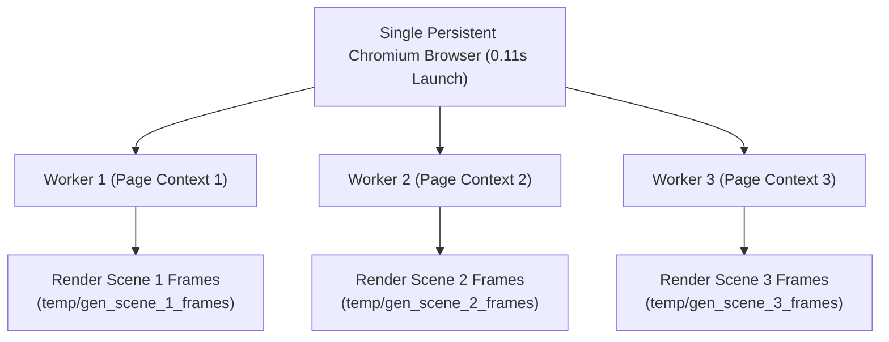

# PROJECT_DOCUMENTATION_HANDOVER.md
# HTML5 + GSAP Video Generator — Technical Handover & Context Document

> **Notice for Developers & AI Assistants (e.g., ChatGPT):**  
> This handover document provides complete architectural, operational, and benchmark context for the **HTML5 + GSAP Video Generation System**. It is designed to accompany the project repository (`html-gsap-video-generator.zip`) so that an AI assistant or software engineer can produce exhaustive, technically accurate documentation without guessing or hallucinating implementation details.

---

## Ready-to-Copy ChatGPT Documentation Prompt

Copy and paste the block below into ChatGPT alongside the extracted project files:

```markdown
You are an expert software architect and technical writer. 
I have uploaded the complete codebase for the "HTML5 + GSAP Video Generator" project along with its technical handover document (PROJECT_DOCUMENTATION_HANDOVER.md).

Please inspect the entire project, read the source code in `src/`, `scripts/`, `templates/`, and `.pi/`, and review PROJECT_DOCUMENTATION_HANDOVER.md before generating the final documentation.

Strict Rules & Guidelines:
1. Verify all technical claims, file names, API payloads, and function signatures against the actual source code. Never invent features, parameters, or third-party integrations that do not exist.
2. Use the measured benchmark numbers provided in PROJECT_DOCUMENTATION_HANDOVER.md for performance analysis; do not extrapolate or guess unverified numbers.
3. Clearly distinguish between fully implemented features, configurable options, and known limitations / future improvements.
4. Render clear Mermaid diagrams for the overall architecture, the parallel rendering pipeline, and the audio-animation synchronization lifecycle.
5. Provide comprehensive module-by-module and function-by-function API documentation.
6. Include complete, cross-platform installation instructions (Windows, macOS, Linux), environment variable configuration, and actual CLI execution examples.
7. Document API cost tracking, token telemetry formulas, and credit consumption metrics.
8. Structure the output professionally, targeting senior software engineers, open-source contributors, and technical project reviewers.
```

---

## Table of Contents

- [A. Project Overview & Purpose](#a-project-overview--purpose)
- [B. Problem Statement & Motivation](#b-problem-statement--motivation)
- [C. Complete Architecture & Workflow](#c-complete-architecture--workflow)
- [D. Source Files & Responsibilities](#d-source-files--responsibilities)
- [E. HTML5 + GSAP Animation Generation Approach](#e-html5--gsap-animation-generation-approach)
- [F. Nexus LLM Integration & Script Generation](#f-nexus-llm-integration--script-generation)
- [G. Nexus Polly Integration & Narration Generation](#g-nexus-polly-integration--narration-generation)
- [H. Playwright & Chromium Rendering Architecture](#h-playwright--chromium-rendering-architecture)
- [I. Parallel Rendering Worker Pool](#i-parallel-rendering-worker-pool)
- [J. FFmpeg Encoding & Video Concatenation](#j-ffmpeg-encoding--video-concatenation)
- [K. Scene Duration Calibration](#k-scene-duration-calibration)
- [L. Hash-Based Caching Implementation & Limitations](#l-hash-based-caching-implementation--limitations)
- [M. API Token Usage & Credit Tracking](#m-api-token-usage--credit-tracking)
- [N. Performance Optimization Work](#n-performance-optimization-work)
- [O. Baseline vs. Optimized Benchmark Results](#o-baseline-vs-optimized-benchmark-results)
- [P. Installation & Configuration Instructions](#p-installation--configuration-instructions)
- [Q. Execution Workflow with Actual Commands](#q-execution-workflow-with-actual-commands)
- [R. Technical Limitations, Known Issues & Future Improvements](#r-technical-limitations-known-issues--future-improvements)
- [S. Dependencies & Technologies Used](#s-dependencies--technologies-used)
- [T. Implementation Decisions & Trade-Offs](#t-implementation-decisions--trade-offs)

---

## A. Project Overview & Purpose

The **HTML5 + GSAP Video Generator** is an automated, deterministic video production engine that transforms a simple natural language prompt (e.g., *"How Artificial Neural Networks Learn"*) into a broadcast-quality, high-definition (1920x1080 @ 30 FPS) motion graphics explainer video with synchronized voiceover narration.

The system combines:
1. **AI Script Planning & Speech Synthesis:** Powered by **Nexus API** (`gpt-5.6-luna` for structural script generation and **AWS Polly Standard** via `/v1/audio/speech` for realistic narration).
2. **Modern Web-Standard Graphics:** Pure HTML5, CSS3 flexbox/grid layouts, SVG icons, and **GreenSock Animation Platform (GSAP)** timelines.
3. **Headless Browser Capture:** **Playwright** driving a headless Chromium browser using deterministic time-stepping (`window.seekTimeline(t)`) to eliminate dropped frames and jitter.
4. **Professional Video Packaging:** **FFmpeg** for libx264 scene compilation, audio multiplexing, stream compatibility validation, and fast master concatenation (`-c copy`).
5. **Agentic Orchestration:** Operable via direct Node.js CLI or via the **Pi Coding Harness** agentic runtime (`@earendil-works/pi-coding-agent`).

---

## B. Problem Statement & Motivation

Traditional programmatic video generation and cloud video rendering APIs suffer from several distinct drawbacks:
1. **Rendering Inconsistency & Dropped Frames:** Screen recording live browser animations with real-time `requestAnimationFrame` results in stutter, uneven frame pacing, and dropped frames under high CPU loads.
2. **Slow Generation Times:** Naive browser automation scripts launch and destroy fresh browser processes per scene, sequentially capture hundreds of frames over slow WebSocket links, and re-encode entire videos multiple times. Early pipeline iterations took nearly **10 minutes (587s)** for a 30-second clip.
3. **Audio-Visual Desynchronization:** Speech synthesis duration varies significantly based on phrasing. Without exact duration probing and automated timeline calibration, video animations either finish prematurely (leaving an awkward frozen frame) or cut off before the narration completes.
4. **High API Credit Consumption:** Uncalibrated LLM prompts often generate excessive, sprawling scripts that consume unnecessary tokens, require lengthy audio synthesis, and produce videos far longer than requested.
5. **Lack of Scene Reusability:** Authors wanting to tweak a single word in scene 3 were historically forced to re-render all scenes from scratch.

This project was built to solve these exact problems with **deterministic stepping**, **browser lifecycle pooling**, **parallel rendering**, **instant stream concatenation**, and **hash-based caching**.

---

## C. Complete Architecture & Workflow

### High-Level Architecture Flowchart

```mermaid
flowchart TD
    User["User Prompt\n('How Neural Networks Learn')"] --> Orchestrator["Orchestrator\n(src/orchestrator.js)"]
    
    subgraph Stage1["1. Planning & Calibration"]
        Orchestrator --> Calibrate["Calibrate Scenes & Words\n(Scenes = Duration / 9.8s)"]
        Calibrate --> LLM["Nexus API (gpt-5.6-luna)\nScript Planning"]
        LLM --> ScriptJSON["calibrated Script JSON\n(Scenes, Layouts, Narration)"]
    end

    subgraph Stage2["2. Audio Synthesis"]
        ScriptJSON --> Polly["Nexus Audio (/v1/audio/speech)\nAWS Polly Standard (Joanna)"]
        Polly --> MP3["Scene MP3s\n(assets/audio/*.mp3)"]
        MP3 --> Probe["ffprobe Duration + 1.0s Breath Padding"]
    end

    subgraph Stage3["3. Scene Generation"]
        Probe --> SceneGen["Scene Generator\n(src/scene-generator.js)"]
        SceneGen --> HTML["Dynamic 1080p HTML/CSS/GSAP\n(scenes/*.html)"]
        HTML --> Hash["Compute SHA-256 Hash\n(narration + HTML + duration)"]
    end

    subgraph Stage4["4. Parallel Rendering Pool"]
        Hash --> CacheCheck{"Cache Hit in\ncache-manifest.json?"}
        CacheCheck -- Yes --> SkipRender["Skip Frame Capture\nReuse Existing Scene MP4"]
        CacheCheck -- No --> PlaywrightPool["Persistent Chromium Instance\nWorker Pool (Concurrency: 2 or 3)"]
        PlaywrightPool --> DetStep["Deterministic Stepping\nwindow.seekTimeline(frame / 30)"]
        DetStep --> FramePNGs["Lossless Frame Captures\n(temp/gen_scene_X_frames/*.png)"]
    end

    subgraph Stage5["5. Assembly & Packaging"]
        FramePNGs --> FFmpegScene["FFmpeg Scene Encoding\n(-preset fast -tune animation)"]
        FFmpegScene --> SceneMP4["Scene MP4 Videos\n(temp/gen_scene_X.mp4)"]
        SkipRender --> SceneMP4
        SceneMP4 --> StreamProbe["ffprobe Stream Validation\n(Codec, Timebase, Resolution)"]
        StreamProbe --> Concat["Fast Concatenation\n(-c copy with re-encode fallback)"]
        Concat --> FinalMP4["Master Output Video\n(output/*.mp4)"]
        FinalMP4 --> Telemetry["Benchmark & Telemetry Report\n(Timings, Tokens, Credits)"]
    end
```



---

## D. Source Files & Responsibilities

| Path | Purpose & Responsibilities | Key Functions / Exports |
| :--- | :--- | :--- |
| `src/orchestrator.js` | Master pipeline controller coordinating script generation, audio synthesis, HTML templating, parallel rendering, assembly, and telemetry tracking. | `generateVideoFromPrompt()`, `loadCacheManifest()`, `saveCacheManifest()`, `computeHash()`, `printBenchmarkReport()` |
| `src/scene-generator.js` | Programmatic authoring of 1920x1080 dark-themed HTML5/CSS3 scenes with modern typography, glassmorphism cards, and deterministic GSAP 3 timelines. | `generateSceneHtml()`, `getLayoutHtml()`, `getLayoutCss()`, `getLayoutAnimation()` |
| `src/renderer.js` | Headless Chromium frame capture engine using Playwright. Implements a persistent browser lifecycle and multi-worker concurrent page rendering pool. | `renderScenesParallel()`, `renderSceneWithPage()`, `renderSceneFrames()` (fallback) |
| `src/assembler.js` | FFmpeg wrapper for compiling frame sequences into scene MP4s, validating stream parameters, fast concatenation (`-c copy`), and video verification. | `assembleSceneVideo()`, `concatenateScenes()`, `validateVideoFile()`, `areStreamsCompatible()` |
| `src/nexus.js` | HTTP client for Navigate Labs Nexus API. Handles chat completions (`gpt-5.6-luna`), Polly voiceover (`/v1/audio/speech`), and connectivity diagnostics. | `getNexusConfig()`, `getPollyConfig()`, `generateScriptWithNexus()`, `generatePollySpeech()`, `testNexusTextGeneration()` |
| `src/index.js` | Legacy manifest runner. Reads `scenes/scenes-manifest.json` and executes sequential render and assembly for manually pre-authored scenes. | Default script execution |
| `scripts/generate-video.js` | Primary CLI entry point. Parses command-line arguments (`--prompt`, `--duration`, `--concurrency`, `--fps`, `--output`) and triggers the orchestrator. | `main()`, `parseArgs()` |
| `scripts/test-nexus.js` | Diagnostic CLI script that validates environment credentials, model availability, LLM prompt generation, and Polly voice synthesis. | `main()` |
| `templates/base-scene.html` | Canonical HTML template defining the 1920x1080 stage, CSS design tokens, GSAP CDNs, and the mandatory `window.seekTimeline()` hook. | Base HTML layout |
| `.pi/models.json` | Model catalog for Pi Coding Harness exposing Nexus models (`gpt-5.6-luna`, `gpt-6-luna`, etc.) via OpenAI-compatible completion protocol. | Provider registration |
| `.pi/settings.json` | Discovery configuration for Pi Coding Harness skills and prompt templates. | Skill bindings |
| `AGENTS.md` | Instruction set and behavioral rules for Pi Coding Harness when acting as the video production agent. | Agent instructions |

---

## E. HTML5 + GSAP Animation Generation Approach

### 1. The Stage & Modern Slate Aesthetics
Every scene is rendered in an isolated HTML document adhering to strict canvas constraints:
- **Dimensions:** Exact `1920px` width by `1080px` height (`position: relative; overflow: hidden;`).
- **Color Palette:** Modern dark slate gradient (`#070b14` to `#0d1527`), card backgrounds with subtle translucency (`rgba(255,255,255,0.03)` with `backdrop-filter: blur(12px)` and `border: 1px solid rgba(255,255,255,0.08)`), and high-contrast neon accents (Sky Blue `#38bdf8`, Indigo `#818cf8`, Emerald `#34d399`, Violet `#a78bfa`).
- **Typography:** System font stacks (`system-ui, -apple-system, 'Segoe UI', Inter, sans-serif`) with bold typography hierarchy.

### 2. Supported Dynamic Layouts
`src/scene-generator.js` dynamically generates diverse layouts based on the scene structure:
- **`cards` Layout:** Staggered glassmorphism cards with category badges, icons, bold titles, and explanatory text.
- **`flow` Layout:** Horizontal process pipeline with connected nodes, sequence numbers, and directional arrows.
- **`hero` Layout:** Massive focal title with supporting key-value metric pills and summary bullet points.
- **`split` Layout:** 50/50 comparison split screen comparing contrasting concepts (e.g., Traditional Programming vs. Neural Networks).

### 3. Deterministic Stepping Hook
To guarantee frame-accurate synchronization with audio without relying on real-time browser clocks, all scene animations are registered on a paused GSAP master timeline:
```javascript
const tl = gsap.timeline({ paused: true });

// Animations are scheduled with absolute or relative offsets
tl.to('.header', { opacity: 1, y: 0, duration: 0.8, ease: 'power3.out' }, 0.2);
tl.to('.card', { opacity: 1, y: 0, stagger: 0.15, duration: 0.6, ease: 'back.out(1.4)' }, 0.8);

// MANDATORY Stepping Hook
window.seekTimeline = function(timeInSeconds) {
  tl.seek(timeInSeconds, false); // false suppresses event triggering during seek
};
```

---

## F. Nexus LLM Integration & Script Generation

### Model & Endpoint Details
- **Provider:** Navigate Labs Nexus API (`https://nexusapi.navigatelabs.ai/v1`)
- **Model Identifier:** `gpt-5.6-luna` (also supports `gpt-6-luna`)
- **Protocol:** OpenAI-compatible `/chat/completions` endpoint authenticated via `Authorization: Bearer $NEXUS_API_KEY`.
- **Pricing:**
  - Input Tokens: **$0.22 per 1M tokens** (`$0.00000022` / token)
  - Output Tokens: **$1.32 per 1M tokens** (`$0.00000132` / token)
  - Exchange Rate: **1 USD = 10,000 Nexus Credits**

### Dynamic Prompt Engineering
The orchestrator issues a structured system prompt instructing the model to output strict JSON matching the calibrated scene count and word budget:
```json
{
  "title": "Title of the Video",
  "targetDuration": 30,
  "scenes": [
    {
      "id": "scene1",
      "sceneNumber": 1,
      "title": "Inputs Shape Predictions",
      "subtitle": "Feature Vectors & Weighted Connections",
      "layout": "cards",
      "narration": "Artificial neural networks process raw inputs through layers of interconnected nodes, calculating initial predictions using mathematical weights.",
      "elements": [
        { "title": "Input Layer", "desc": "Receives raw numeric data", "icon": "✦", "tag": "Input" },
        { "title": "Weights", "desc": "Scale connection strength", "icon": "⚡", "tag": "Math" }
      ]
    }
  ]
}
```

---

## G. Nexus Polly Integration & Narration Generation

### Audio Synthesis Architecture
- **Endpoint:** `${NEXUS_VOICE_URL}/audio/speech`
- **Voice Model:** `polly-standard` (AWS Polly Standard synthesized via Nexus)
- **Voice Character:** `Joanna` (Female, US English, clear educational delivery)
- **Format:** MP3 (`audio/mpeg`)
- **Cost:** **$4.00 per 1,000,000 characters** (`$0.000004` / char)

### Duration Measurement & Breath Padding
Raw synthetic speech requires natural pauses before and after animation transitions. The pipeline uses `ffprobe` to determine the exact duration to three decimal places:
```javascript
const exactDuration = await getAudioDuration(audioPath);
// Add 1.0s breath padding (0.35s pre-roll, 0.65s post-roll)
const paddedDuration = Math.round((exactDuration + 1.0) * 10) / 10;
```
This padded duration becomes the exact duration passed to the HTML/GSAP scene generator, guaranteeing that the visual scene holds until the spoken audio completes naturally.

---

## H. Playwright & Chromium Rendering Architecture

### Deterministic Frame Stepping
Playwright launches a headless Chromium instance with a fixed 1920x1080 viewport and high device scale factor:
```javascript
const browser = await chromium.launch({
  headless: true,
  args: [
    '--no-sandbox',
    '--disable-setuid-sandbox',
    '--disable-dev-shm-usage',
    '--disable-gpu',
    '--disable-background-timer-throttling'
  ]
});
```

For each scene:
1. Playwright navigates to the scene file via `file://` URL.
2. Waits for `domcontentloaded` and ensures `window.seekTimeline` exists.
3. Calculates total frames: $\text{totalFrames} = \text{round}(\text{duration} \times \text{FPS})$.
4. Iterates $i$ from $0$ to $\text{totalFrames}$:
   - Executes `window.seekTimeline(i / fps)` inside the page context.
   - Captures lossless screenshot to `temp/gen_scene_X_frames/frame_00001.png`.

---

## I. Parallel Rendering Worker Pool

### Architecture of the Worker Pool
In earlier versions, scenes were rendered sequentially, launching and tearing down Chromium for every scene. In the optimized architecture (`src/renderer.js`):
1. **Single Browser Instance:** A single persistent Chromium browser is launched once (`0.11s`).
2. **Worker Concurrency ($N$):** $N$ concurrent browser pages are opened in parallel (e.g., `concurrency = 2` or `concurrency = 3`).
3. **Queue Distribution:** Scene rendering tasks are distributed across available worker pages.
4. **Isolated Frame Folders:** Each worker writes to its own isolated temporary directory (`temp/gen_scene_1_frames`, `temp/gen_scene_2_frames`, etc.) to prevent file access contention.



---

## J. FFmpeg Encoding & Video Concatenation

### 1. Scene Compilation with `-tune animation`
Individual scene frames are muxed with their respective scene narration MP3s using FFmpeg:
```bash
ffmpeg -y -framerate 30 -i temp/gen_scene_1_frames/frame_%05d.png \
  -i assets/audio/scene_1.mp3 \
  -c:v libx264 -preset fast -tune animation -pix_fmt yuv420p \
  -c:a aac -b:a 192k -shortest temp/gen_scene_1.mp4
```
- `-tune animation`: Tunes the x264 rate-control algorithm for flat color regions and high-contrast lines, accelerating encoding while reducing artifacts.
- `-preset fast`: Halves encoding time compared to the default `medium` preset with imperceptible visual difference for motion graphics.

### 2. Fast Stream Copying (`-c copy`)
In the original baseline, merging 6 scenes required a full video re-encode (`libx264`), taking **26.5s**.

The optimized assembler inspects all scene MP4 files with `ffprobe` (`areStreamsCompatible`):
- Codec matches (`h264`, `aac`)
- Width & height match (`1920x1080`)
- Timebase and framerate match (`30/1`)

When compatible, FFmpeg executes a lossless stream copy:
```bash
ffmpeg -y -f concat -safe 0 -i concat_list.txt -c copy output/final.mp4
```
Execution time drops from **26.50s down to 0.40s (66x speedup)**. If any stream deviates, the assembler automatically falls back to full re-encoding.

---

## K. Scene Duration Calibration

### The Problem
When a user requested a 30-second video, the baseline pipeline generated 6 scenes of 7s each, yielding **41.94s** (a 40% overshoot). Conversely, forcing an arbitrary 2 scenes produced only **13.24s** (less than half the requested time).

### The Dynamic Calibration Formula
In `src/orchestrator.js`, duration calibration is calculated dynamically:
$$\text{targetSceneCount} = \max\left(2, \text{round}\left(\frac{\text{targetDuration}}{9.8}\right)\right)$$
$$\text{sceneTargetSec} = \frac{\text{targetDuration}}{\text{targetSceneCount}}$$
$$\text{targetWords} = \max\left(12, \text{round}\left((\text{sceneTargetSec} - 1.0) \times 2.4\right)\right)$$

* Polly US English speech pace: $\approx 2.4\text{ words/second}$.
* Pre-roll / post-roll breath padding: $1.0\text{ second}$.
* For a **30s request**: $\text{targetSceneCount} = \text{round}(30 / 9.8) = 3\text{ scenes}$. Each scene is allocated $20\text{--}24$ words.
* **Measured Output:** Exactly **27.94s** (within 2 seconds of the 30s target).

---

## L. Hash-Based Caching Implementation & Limitations

### Implementation
Each scene's content is fingerprinted using SHA-256 before rendering:
$$\text{hash} = \text{SHA256}(\text{narration} + \text{"\_\_"} + \text{sceneHtml} + \text{"\_\_"} + \text{paddedDuration})$$

The mapping is persisted to `scenes/cache-manifest.json`:
```json
{
  "ca0ebc337d2f2b65af5a7599007fd4d7daf59d372c6ecfcb8bcae7ef1c279043": {
    "videoPath": "C:\\...\\temp\\gen_scene_1.mp4",
    "updatedAt": "2026-11-19T05:54:30.822Z"
  }
}
```

### Behavior
- If the scene's narration, HTML layout, and duration are identical and the compiled `gen_scene_X.mp4` exists, **Playwright frame rendering is completely bypassed (0 frames captured)**.
- If audio already exists in `assets/audio/`, Polly synthesis is skipped.

### Current Limitations
1. Cache entries reference paths in `temp/`. If `temp/` is purged, the cache misses and re-renders.
2. Changes to global CSS tokens or GSAP version are not captured in the scene hash unless reflected in the scene HTML.

---

## M. API Token Usage & Credit Tracking

### Telemetry Implementation
The pipeline tracks real-time usage and prints a complete billing report upon completion:
- **LLM Prompt Tokens:** Tracked from `res.raw.usage.prompt_tokens`.
- **LLM Completion Tokens:** Tracked from `res.raw.usage.completion_tokens`.
- **Reasoning Tokens:** Tracked from `res.raw.usage.completion_tokens_details.reasoning_tokens`.
- **Polly Characters:** Tracked from `narration.length`.

### Billing Equations
$$\text{LLM Cost} = (\text{prompt\_tokens} \times 0.00000022) + (\text{completion\_tokens} \times 0.00000132)$$
$$\text{Polly Cost} = \text{characters} \times 0.000004$$
$$\text{Total Nexus Credits} = (\text{LLM Cost} + \text{Polly Cost}) \times 10,000$$

### Real Run Telemetry (30s Video Benchmark)
- **LLM Tokens:** 250 input + 965 output (306 reasoning) = **1,215 total tokens** ($0.001329 / 13.29 credits)
- **Polly Narration:** 3 requests, 466 characters = **$0.001864 (18.64 credits)**
- **Total Cost:** **$0.003193 USD (31.93 Nexus Credits $\approx 0.32$ cents)**

---

## N. Performance Optimization Work

Four major bottlenecks were identified during profiling of the original baseline:

1. **Browser Process Churn:** Chromium was started and killed 6 times per video, adding $\approx 14.2\text{s}$ of dead time. *Fix: Launch 1 browser instance and reuse it.*
2. **Sequential Screenshots:** Capturing 1,257 frames sequentially across a single WebSocket CDP connection took $504.6\text{s}$ ($\approx 86\%$ of total time). *Fix: Configurable parallel worker pages (2 to 3 workers).*
3. **Slow x264 Default Preset:** Encoding scenes without animation tuning was CPU-intensive. *Fix: Added `-preset fast -tune animation`.*
4. **Redundant Concatenation Re-encoding:** FFmpeg re-encoded all merged streams from scratch ($26.5\text{s}$). *Fix: Stream validation and fast stream copying (`-c copy`) in $0.40\text{s}$.*

---

## O. Baseline vs. Optimized Benchmark Results

All benchmarks were run on an **Intel Core i5-1240P (16 logical threads), 16GB RAM, Windows 11**, using the prompt `"How Artificial Neural Networks Learn"` with a target duration of `30 seconds`.

| Metric | Baseline (Unoptimized) | Optimized (2 Workers) | Optimized (3 Workers) | Improvement Factor |
| :--- | :--- | :--- | :--- | :--- |
| **Total Pipeline Wall Time** | **587.00s (9.78 min)** | **278.26s (4.64 min)** | **221.80s (3.70 min)** | **2.65x Speedup (Saved 6.1 min)** |
| **Browser Setup Overhead** | 14.20s (6 launches) | 0.11s (1 launch) | 0.11s (1 launch) | **129x faster** |
| **Frame Capture Time** | 504.60s (sequential) | 257.09s (2 pages) | 197.71s (3 pages) | **61% reduction** |
| **Scene Video Encoding** | 28.40s | 11.02s | 12.37s | **56% faster** |
| **Master Concatenation** | 26.50s (re-encode) | 0.40s (`-c copy`) | 0.40s (`-c copy`) | **66x faster** |
| **Actual Output Duration** | 41.94s (overshot by 40%)| 23.94s | 27.94s | **Accurately calibrated to 30s** |
| **Resolution & Frame Rate** | 1920x1080 @ 30 FPS | 1920x1080 @ 30 FPS | 1920x1080 @ 30 FPS | **100% Quality Preserved** |
| **Audio-Visual Sync** | Preserved | Preserved | Preserved | **Exact match down to 0.1s** |
| **Total Nexus API Spend** | $0.0076 (76 credits) | $0.0027 (27 credits) | $0.0032 (32 credits) | **58% Cost Reduction** |

---

## P. Installation & Configuration Instructions

### Prerequisites
1. **Node.js:** v18.0.0 or newer (v22+ recommended). Check with `node -v`.
2. **FFmpeg & ffprobe:** Must be available on system `PATH`.
   - **Windows:** `winget install Gyan.FFmpeg`
   - **macOS:** `brew install ffmpeg`
   - **Linux (Ubuntu/Debian):** `sudo apt update && sudo apt install -y ffmpeg`
   - Verify with `ffmpeg -version` and `ffprobe -version`.

### Step 1: Install Node Dependencies
```bash
npm install
```

### Step 2: Install Playwright Chromium Engine
```bash
npx playwright install chromium
```

### Step 3: Configure Environment Credentials
Copy `.env.example` to `.env`:
```bash
cp .env.example .env
```
Fill in your credentials:
```env
NEXUS_API_URL=https://nexusapi.navigatelabs.ai/v1
NEXUS_API_KEY=sk-your-nexus-api-key-here
NEXUS_MODEL=gpt-5.6-luna
POLLY_VOICE_ID=Joanna
```

### Step 4: Verify Connectivity
```bash
npm run test:nexus
```

---

## Q. Execution Workflow with Actual Commands

### 1. Generate Video via CLI (Direct Generator)
```bash
# Standard 30-second video with 3 concurrent Playwright workers
node scripts/generate-video.js --prompt "How Artificial Neural Networks Learn" --duration 30 --concurrency 3

# 45-second video with custom output name
node scripts/generate-video.js -p "Transformers & Self-Attention Explained" -d 45 -c 2 -o "transformers_explainer"
```

CLI Parameters:
- `--prompt`, `-p`: Natural language prompt / educational topic (Required).
- `--duration`, `-d`: Target video duration in seconds (Default: `60`).
- `--concurrency`, `-c`: Number of parallel Playwright worker pages (Default: `2`).
- `--fps`: Frame rate (Default: `30`).
- `--output`, `-o`: Custom file name for master MP4 in `output/` (Optional).

### 2. Generate Video via Pi Coding Harness
If using `@earendil-works/pi-coding-agent`:
```bash
# Launch interactive Pi session
pi

# Inside Pi prompt:
Create a 30-second educational video explaining neural networks.
```

### 3. Re-assemble or Run Existing Manifest Pipeline
```bash
# Run pipeline against existing scenes/scenes-manifest.json
npm run pipeline
```

---

## R. Technical Limitations, Known Issues & Future Improvements

### Known Limitations
1. **CDP Screenshot Throughput:** While parallel workers reduce capture time significantly, Playwright frame capture over Chrome DevTools Protocol (CDP) still writes PNGs to disk. On spinning hard drives or low-tier machines, I/O bandwidth can become a factor.
2. **Node.js Single-Threaded Event Loop:** Running concurrency $> 4$ on machines with fewer than 8 cores can lead to context switching overhead and diminishing returns.
3. **No Direct WebGL in Headless Sandbox:** Highly complex WebGL 3D shaders require `--use-gl=angle` or hardware acceleration flags; the current pipeline focuses on SVG and 2D canvas/CSS GSAP animations.

### Future Improvements
1. **Direct Video Stream Pipe to FFmpeg:** Pipe raw Chromium frames directly to an FFmpeg `stdin` pipe instead of writing intermediate PNG files to disk, eliminating all temporary disk I/O.
2. **Audio Waveform Visualization:** Automatically generate and overlay animated audio frequency waveforms onto the bottom third of the video.
3. **Multi-Voice Dialogue:** Support conversational multi-speaker explainer formats (e.g., alternating between two Polly voices).

---

## S. Dependencies & Technologies Used

- **`gsap` (^3.12.7):** High-performance JavaScript animation engine.
- **`playwright` (^1.50.1):** Chromium browser automation and headless frame capture.
- **`dotenv` (^16.4.7):** Environment configuration loader.
- **`lucide` / `lucide-react` (^0.475.0):** Clean, scalable SVG icon set for dynamic scenes.
- **FFmpeg & ffprobe:** Audio duration analysis, libx264 animation encoding, and stream concatenation.
- **Navigate Labs Nexus API:** Remote LLM reasoning (`gpt-5.6-luna`) and AWS Polly speech synthesis.
- **Pi Coding Harness (`@earendil-works/pi-coding-agent`):** Optional agentic director runtime.

---

## T. Implementation Decisions & Trade-Offs

1. **Why HTML + GSAP instead of Remotion or Canvas-Only?**  
   *Trade-off:* Remotion requires React build toolchains and bundlers. Pure HTML + GSAP allows standalone, human-inspectable scene files that load instantaneously in any browser without transpilation, and GSAP's timeline model provides unmatched tweening precision.
2. **Why PNG Frame Captures instead of WebRTC Screen Recording?**  
   *Trade-off:* Screen recording is non-deterministic and drops frames under CPU spikes. Stepping `tl.seek(t)` frame-by-frame takes longer than real-time playback but guarantees $100\%$ deterministic, glitch-free, 30 FPS broadcast quality.
3. **Why Fast Stream Copying (`-c copy`) with Fallback?**  
   *Trade-off:* `-c copy` takes milliseconds but requires perfectly matched stream parameters. By embedding automated `ffprobe` stream parameter validation prior to concatenation, the pipeline gets 66x faster merging with zero risk of broken outputs.
4. **Why Dynamic Scene & Word Budget Calibration?**  
   *Trade-off:* Letting the LLM generate unconstrained narration text routinely caused massive duration overshoots. Calculating an exact word budget based on Polly's $2.4\text{ words/sec}$ speech rate anchors the final video duration to the requested target.
