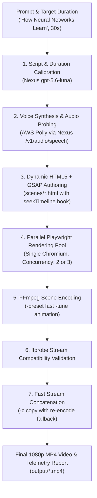

# HTML + GSAP Video Generator

An automated, deterministic prompt-to-video production pipeline powered by **HTML5/CSS3**, **GSAP 3**, **Playwright**, **FFmpeg**, and **Nexus API** (LLM Script Planning + AWS Polly Voiceover).

Convert natural language prompts (e.g., *"How Artificial Neural Networks Learn"*) into broadcast-ready, high-definition (**1080p @ 30 FPS**) motion-graphics explainer videos with synchronized voiceover narration in under 4 minutes.

---

## 1. Architecture & Workflow



---

## 2. Key Features

- **Deterministic Stepping:** Animations are paused (`gsap.timeline({ paused: true })`) and stepped frame-by-frame via `window.seekTimeline(t)`. No dropped frames, jitter, or timing drifts.
- **Audio-Visual Synchronization:** Audio duration is probed with `ffprobe` and padded with $1.0\text{s}$ breath margins ($0.35\text{s}$ pre-roll, $0.65\text{s}$ post-roll) to match GSAP animations to the millisecond.
- **Persistent Browser & Parallel Worker Pool:** Launches a single Chromium instance and renders scenes in parallel across configurable concurrent worker pages (`--concurrency 2` or `3`).
- **Fast Stream Concatenation:** Pre-inspects streams and stitches scenes using `-c copy` in **`0.40s`** (66x faster than re-encoding) with automated re-encode fallback.
- **Dynamic Duration Calibration:** Automatically calculates optimal scene count and word budgets so a 30s request yields a ~30s video.
- **Hash-Based Caching:** Fingerprints scene HTML, duration, and narration with SHA-256 to skip re-rendering unchanged scenes.
- **Real-Time Telemetry & Cost Tracking:** Automatically prints LLM tokens (input, output, reasoning), Polly characters, dollar costs, and Nexus credit consumption.

---

## 3. Performance Benchmarks

Measured on **Intel Core i5-1240P (16 threads), 16GB RAM, Windows 11**:
*Prompt: "How Artificial Neural Networks Learn" (Target: 30s)*

| Metric | Baseline | Optimized (2 Workers) | Optimized (3 Workers) | Speedup |
| :--- | :--- | :--- | :--- | :--- |
| **Total Pipeline Time** | **587.00s (9.78 min)** | **278.26s (4.64 min)** | **221.80s (3.70 min)** | **2.65x Faster (Saved 6.1 min)** |
| **Browser Startup Overhead** | 14.20s (6 launches) | 0.11s (1 launch) | 0.11s (1 launch) | **129x Faster** |
| **Frame Capture Time** | 504.60s (sequential) | 257.09s (2 pages) | 197.71s (3 pages) | **61% Reduction** |
| **Scene Video Encoding** | 28.40s | 11.02s | 12.37s | **56% Faster** |
| **Master Concatenation** | 26.50s (re-encode) | 0.40s (`-c copy`) | 0.40s (`-c copy`) | **66x Faster** |
| **Output Video Duration** | 41.94s (overshoot) | 23.94s | 27.94s | **Calibrated to 30s** |
| **Resolution & FPS** | 1920x1080 @ 30 FPS | 1920x1080 @ 30 FPS | 1920x1080 @ 30 FPS | **Zero Quality Loss** |
| **Total Nexus API Cost** | $0.0076 (76 credits) | $0.0027 (27 credits) | $0.0032 (32 credits) | **58% Cost Reduction** |

---

## 4. Prerequisites & Installation

### 1. Prerequisites
- **Node.js**: v18.0.0 or newer (v22+ recommended).
- **FFmpeg & ffprobe**: Must be installed and available on system `PATH`.

#### Installing FFmpeg
- **Windows (PowerShell):**
  ```powershell
  winget install Gyan.FFmpeg
  ```
- **macOS (Homebrew):**
  ```bash
  brew install ffmpeg
  ```
- **Linux (Ubuntu / Debian):**
  ```bash
  sudo apt update && sudo apt install -y ffmpeg
  ```
Verify FFmpeg installation:
```bash
ffmpeg -version
ffprobe -version
```

### 2. Install Project Dependencies
```bash
npm install
```

### 3. Install Playwright Chromium Engine
```bash
npx playwright install chromium
```

### 4. Configure Environment Credentials
Copy `.env.example` to `.env`:
```bash
cp .env.example .env
```
Fill in your credentials:
```env
# Nexus AI Configuration (Navigate Labs Nexus API)
NEXUS_API_URL=https://nexusapi.navigatelabs.ai/v1
NEXUS_API_KEY=sk-your-nexus-api-key-here
NEXUS_MODEL=gpt-5.6-luna

# AWS Polly Voice Configuration
NEXUS_VOICE_URL=https://nexusapi.navigatelabs.ai/v1
NEXUS_VOICE_API_KEY=sk-your-nexus-api-key-here
POLLY_VOICE_ID=Joanna
POLLY_ENGINE=standard
POLLY_OUTPUT_FORMAT=mp3

# Video Configuration
VIDEO_WIDTH=1920
VIDEO_HEIGHT=1080
VIDEO_FPS=30
```

### 5. Verify API Connectivity
```bash
npm run test:nexus
```

---

## 5. Usage & Video Generation

### Direct CLI Video Generator
Generate a video from a prompt using `scripts/generate-video.js`:
```bash
# Standard 30-second explainer with 2 concurrent workers
node scripts/generate-video.js --prompt "How Artificial Neural Networks Learn" --duration 30 --concurrency 2

# High-performance run with 3 workers and custom output name
node scripts/generate-video.js -p "Transformers & Self-Attention Explained" -d 45 -c 3 -o "transformers_explainer"
```

#### CLI Options
| Flag | Short | Default | Description |
| :--- | :--- | :--- | :--- |
| `--prompt` | `-p` | *(Required)* | Topic or natural language prompt for the explainer video |
| `--duration`| `-d` | `60` | Target video duration in seconds |
| `--concurrency` | `-c` | `2` | Number of concurrent Playwright browser worker pages (e.g. `2` or `3`) |
| `--fps` | | `30` | Frame rate (frames per second) |
| `--output` | `-o` | *(Prompt-based)* | Custom filename for master MP4 in `output/` |

### Using with Pi Coding Harness (`pi`)
This project is pre-configured for the **Pi Coding Harness** agent runtime:
```bash
# Launch interactive Pi session
pi

# Inside Pi prompt:
Create a 30-second educational video explaining neural networks.
```

### Re-running Existing Manifest
If you have manually edited scenes in `scenes/` and want to compile them:
```bash
npm run pipeline
```

---

## 6. Project Structure

```
html-gsap-video-generator/
├── AGENTS.md                  # Pi Coding Harness master director instructions
├── PROJECT_DOCUMENTATION_HANDOVER.md # Complete technical handover & ChatGPT prompt
├── .env.example               # Template environment configuration
├── .gitignore                 # Excludes secrets, node_modules, temp frames, large videos
├── package.json               # NPM scripts and dependencies
├── .pi/                       # Pi agent models, settings, and skills
│   ├── models.json            # Nexus AI provider configuration
│   └── settings.json          # Agent discovery paths
├── src/
│   ├── orchestrator.js        # Master pipeline, duration calibration, caching, telemetry
│   ├── renderer.js            # Persistent Chromium instance & parallel worker pool
│   ├── assembler.js           # FFmpeg compilation, stream validation, fast -c copy
│   ├── scene-generator.js     # Dynamic HTML5/CSS3 authoring with GSAP timelines
│   ├── nexus.js               # Nexus API client (gpt-5.6-luna) and Polly speech synthesis
│   └── index.js               # Manifest runner for manually authored scenes
├── scripts/
│   ├── generate-video.js      # Main CLI generator entry point
│   └── test-nexus.js          # API connectivity & speech verification script
├── scenes/                    # Generated & template HTML scenes and manifest files
├── templates/
│   └── base-scene.html        # 1920x1080 HTML template with seekTimeline() hook
├── assets/audio/              # Generated narration MP3 files
└── output/                    # Final compiled MP4 explainer videos
```

---

## 7. Troubleshooting

- **FFmpeg not recognized:** Ensure `ffmpeg` and `ffprobe` are in your system `PATH`. Restart your terminal after installing.
- **Playwright browser missing:** Run `npx playwright install chromium`.
- **401 Unauthorized from Nexus:** Verify that `NEXUS_API_KEY` in `.env` is valid and starts with `sk-`. Run `npm run test:nexus`.
- **CPU throttling during rendering:** If your CPU has fewer than 8 cores, use `--concurrency 2`. On 8+ core CPUs, `--concurrency 3` provides optimal throughput.
- **Node sandbox network blocks:** In agentic sandboxes without external network access, ensure network access is enabled when invoking the Nexus API.

---

## 8. Technical Handover for Teammates & AI

For an exhaustive architectural walkthrough, function signatures, design trade-offs, and a ready-to-copy ChatGPT prompt to generate project documentation, refer to:
👉 **[PROJECT_DOCUMENTATION_HANDOVER.md](file:///c:/Users/shash/Downloads/html-gsap-video-generator/PROJECT_DOCUMENTATION_HANDOVER.md)**
